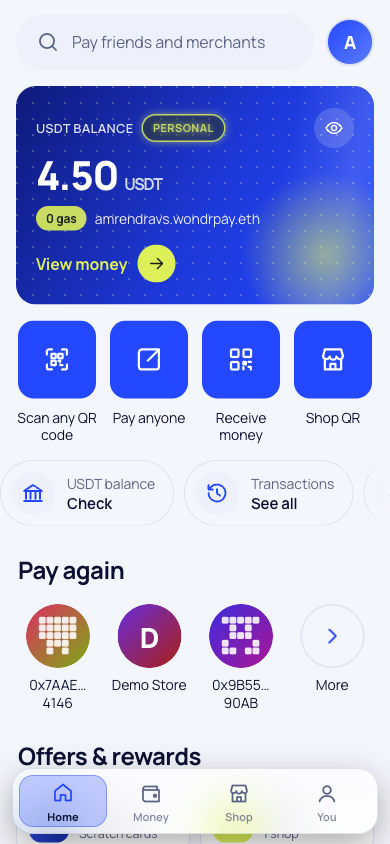
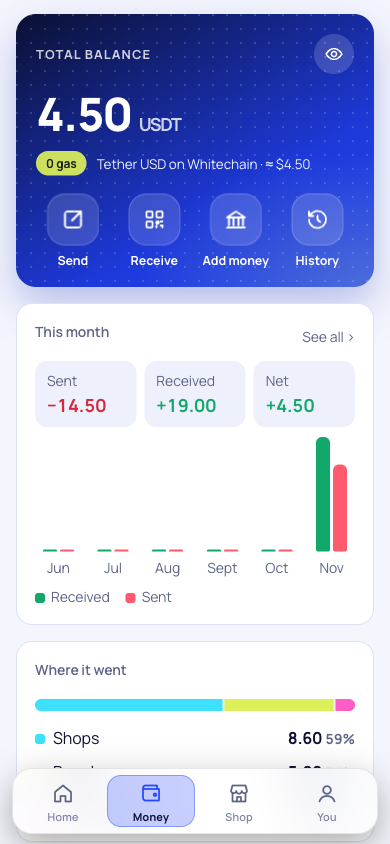
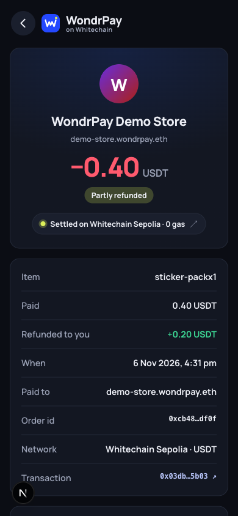
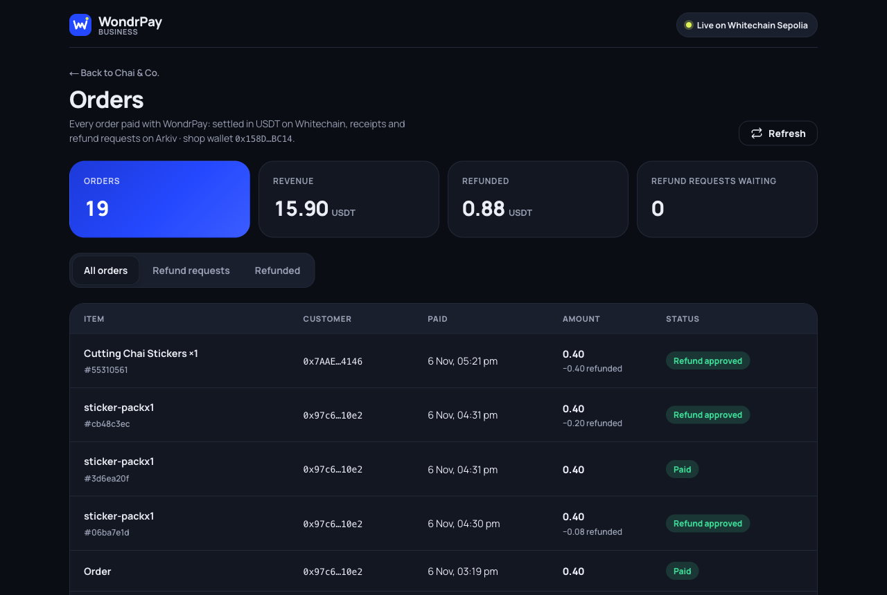
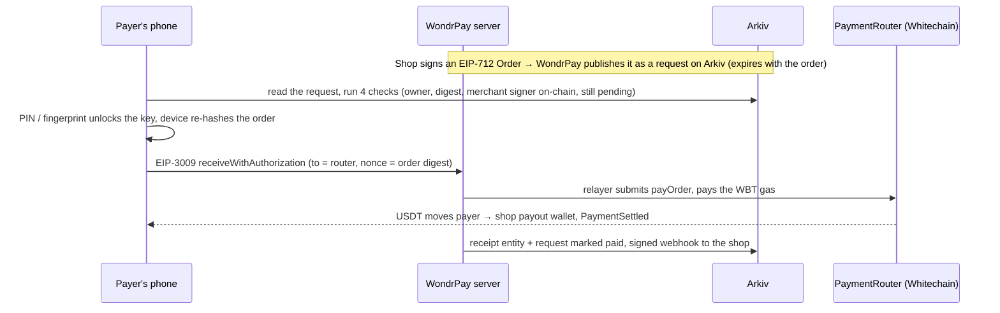

# WondrPay

**UPI for digital dollars.** Pay a name like `chai-shop.wondrpay.eth` in USDT on Whitechain. No gas, no seed phrase, no chain knowledge: a 6-digit PIN or your fingerprint, and the money lands in about 3 seconds. Shops get QR payments, a checkout for any website, refunds, subscriptions and an API.

Built at **ETHGlobal Mumbai 2026** on **Whitechain** (payments), **Arkiv** (live data), **ENS v2** (names) and **World ID** (one human, many wallets).

| | |
|---|---|
| **App** (mobile-first, open on a phone) | https://wondrpay-app.vercel.app |
| **Demo store** (pays with WondrPay) | https://wondrpay-shop.vercel.app |
| **Business portal** (API keys, links, team) | https://wondrpay-app.vercel.app/portal |
| **Developer docs** | https://wondrpay-app.vercel.app/developers |

<p align="center">
  
  
  
</p>
<p align="center">
  
</p>

---

## What you can do

**People**
- **Pay anyone**: scan a QR, or type a name (`priya.wondrpay.eth`) or an address. USDT, gasless.
- **Send money** threads: every person or shop you pay has a chat-style history, with a Pay button at the bottom.
- **A PIN or fingerprint on every payment**, with World ID required above a limit you choose (default $100).
- **Receive** with your own QR. A "money received" pop-up and sound arrive within about a second of the block.
- **Rewards**: scratch cards on shop payments, with cashback in WBT claimed with World ID. Payment sounds can be turned on or off.
- **Refund requests**: ask a shop for a refund with proof. The whole case is signed and stored on Arkiv, so neither side can edit it.
- **MetaMask works too**, extension or WalletConnect, guarded by a WondrPay PIN.

**Shops**
- **Shop QR terminal**: type an amount and show the QR. The screen confirms the moment it settles.
- **Website checkout** with a secret API key, a hosted checkout page, or a one-line Pay button.
- **Payment links and QR codes**, no code needed.
- **Refunds**, by hand or from a capped refund allowance by API, always to the original payer.
- **Subscriptions** (Autopay), a live orders dashboard, CSV export, webhooks with a delivery log, and team roles.

---

## How a payment works



- **The signature can only settle that one order.** Its nonce is the order digest, and only the router can submit it, so it can't be front-run or replayed.
- **Refunds** go only to the original payer and are capped at the amount paid, counted across every refund path.
- **Settlement takes about 3 s.** Whitechain makes a block every ~1 s, and the app watches the chain directly for live updates.

---

## Sponsor integrations

### Whitechain (Sepolia, chain 1874)
| Contract | Address |
|---|---|
| PaymentRouter (verified) | [`0x9f38d33010345dcd62e26640b539263fa139026e`](https://explorer.testnet.whitechain.io/address/0x9f38d33010345dcd62e26640b539263fa139026e) |
| MerchantRegistry (verified) | [`0xe063c2fb8f80c20ff699f9f211be300f58781f68`](https://explorer.testnet.whitechain.io/address/0xe063c2fb8f80c20ff699f9f211be300f58781f68) |
| Autopay factory | [`0x00F61E008AAC480f3D81F959d659c43dDe72ac66`](https://explorer.testnet.whitechain.io/address/0x00F61E008AAC480f3D81F959d659c43dDe72ac66) |
| USDT (official test token) | [`0xcedfB56113143d55b2358b8CFbB0dEB5Ad2f55a7`](https://explorer.testnet.whitechain.io/address/0xcedfB56113143d55b2358b8CFbB0dEB5Ad2f55a7) |

- **Gasless for users.** Payers sign EIP-3009 authorizations and allow-listed relayers pay the WBT gas. Each relayer gets its nonces one at a time, and every transaction is signed once and only ever re-broadcast as-is, so a payment can never go out twice.
- **Autopay.** Subscribers sign one EIP-2612 permit for a dedicated subscription contract. The keeper charges each period, never early, never more than amount × cycles.
- **Refund allowance.** A shop approves a capped USDT allowance with one permit, then refunds by API with no wallet prompt each time.

### Arkiv (Rabdi testnet, chain 7794095)
Arkiv is the live data layer: payment requests whose expiry matches the order deadline, receipts, shop profiles, World ID claims, refund cases (append-only, owned by a burn address), scratch cards, websites and API keys (as hashes), payment links, the webhook log and team members. Every read filters on the WondrPay writer (`0x4D5910272479420d1383100b3986d5fc9d5D658F`), because anyone can write an entity with the same schema name.

```
arkiv.schema = str('whitepay.receipt') AND $owner = addr(0x4D5910272479420d1383100b3986d5fc9d5D658F)
  AND merchant = addr(<shop>) ORDER BY paidAt:u64 DESC
```

### ENS v2 (Ethereum Sepolia)
`wondrpay.eth` has its own UserRegistry (`0xd6cf033a6875456835CeE5F429f9e944a263a1E9`) and PermissionedResolver (`0xc10Ffe23aada8a5cb09DDbe09259e251971844ea`). Each `<name>.wondrpay.eth` stores the holder's Whitechain address under coinType `2147485522` (ENSIP-11, chain 1874), plus `display`, `kind` and `verified` text records. Shops get their name at sign-up, and people claim theirs with World ID. Paying a name resolves it live.

### World ID (IDKit 4, verified on the backend)
- **Unique humans:** one World ID covers up to 5 wallets or shops. An already-verified wallet approves the next one, so no second scan is needed.
- **Step-up above a limit:** large payments need a fresh World ID proof bound to that one payment.
- **Rewards:** each claim is a fresh session proof, and limits count per human across all their wallets.
- **Refund requests:** World ID is required to open one, which deters receipt fraud.

---

## WondrPay for Business (API)

```bash
curl https://wondrpay-app.vercel.app/api/v1/checkout/sessions \
  -H "Authorization: Bearer $WONDRPAY_SECRET_KEY" -H "Content-Type: application/json" \
  -H "Idempotency-Key: order_1042" \
  -d '{"amount":"12.40","reference":"order_1042","successUrl":"https://shop.example.com/thanks"}'
# → { id, status: "open", url: <hosted checkout>, button: <for the Pay button>, … }
```

- **Keys never move money.** API keys sign orders through WondrPay's order key, and payouts always go to the shop's own wallet. A leaked key can create checkouts, not redirect funds.
- **Endpoints:**
  - `POST /api/v1/checkout/sessions` and `GET /api/v1/checkout/sessions/:id`
  - `POST /api/v1/refunds`
  - `GET /api/v1/links/:id` and `POST /api/v1/links/:id/session`
- **Webhooks:** `checkout.session.completed` and `refund.succeeded`, signed (EIP-191) with a delivery log and resend.
- **Pay button** (no server needed with a payment link): `<wondrpay-button link="pl_…">`, from `/sdk/v1.4.0/checkout.js`, SRI-pinned.
- **WooCommerce plugin:** [`integrations/woocommerce`](integrations/woocommerce), also downloadable at `/downloads/wondrpay-for-woocommerce.zip`. For Shopify, use payment links.

Full reference: [`/developers`](https://wondrpay-app.vercel.app/developers) and the architecture notes in [`docs/BUSINESS_API.md`](docs/BUSINESS_API.md).

---

## Repo layout

```
apps/web/              Next.js app: consumer PWA, shop terminal, Business portal, hosted checkout, API routes, docs site
apps/demo-store/       Next.js demo shop (Amaron) paying through WondrPay with an API key
packages/server/       payments, relayer, Arkiv, ENS, World ID, refunds, rewards, Business (sites, keys, links, team)
packages/shared/       chain config, EIP-712 types, limits, Arkiv schemas
packages/checkout/     Checkout SDK (browser) + Node helpers for shop servers
packages/ui/           shared UI kit for the marketing site
contracts/             Foundry: PaymentRouter, MerchantRegistry, Autopay (+ tests)
integrations/          WooCommerce plugin
scripts/               testnet end-to-end tests, ENS setup, deploy helpers
docs/                  architecture, sponsor notes, rewards, Business API, pitch decks
```

## Run it locally

```bash
npm install
cp .env.example .env            # or ./scripts/gen-wallets.sh: fresh keys, prints addresses only
npm run dev                     # app on http://localhost:3000
npm run dev -w @whitepay/demo-store   # demo store on http://localhost:3100
npm run contracts:test          # Foundry tests, incl. fuzzing
npm run typecheck
```

## Tests (real testnet transactions)

| Script | What it proves |
|---|---|
| `scripts/business-flow-test.ts` | sign-up → website + API key → session → gasless payment → paid → rotate / revoke (26 checks) |
| `scripts/business-phase2-test.ts` | payment links, receipts tagged by site and link, integration check, webhook ping + resend (15) |
| `scripts/business-phase3-test.ts` | team roles (developer vs owner), removal kills their keys, local-currency rates (15) |
| `scripts/business-refunds-test.ts` | refund allowance, two racing refunds (only one pays), idempotency, router refund shares the total (17) |
| `scripts/concurrency-test.ts` | parallel payments from one wallet: distinct nonces, ~3.3 s each, no failures |
| `scripts/lifecycle-demo.ts` | the 4 request checks, tamper / forgery / double-pay / expiry all refused |

```bash
npx tsx --env-file=.env scripts/business-flow-test.ts
```

## Deploying

Push deploys are off (`git.deploymentEnabled: false`). A release is one deliberate command from a clean checkout:

```bash
scripts/deploy.sh web store
```

To run your own copy on another Vercel account, use `scripts/setup-vercel-copy.sh` (it copies `.env` without printing secrets).

## Security

- **Payer keys stay on the device.** They're encrypted with the PIN or a passkey (WebAuthn PRF), and every payment asks for one of them.
- **The server never decides a payment alone.** It checks every signature against on-chain state.
- **API secrets are stored as SHA-256 hashes.** Approvals are single-use wallet signatures.
- **Webhooks are SSRF-guarded and signed.**
- Details and how to report a vulnerability: [SECURITY.md](SECURITY.md).

## Notes

- **Testnet only:** Whitechain Sepolia with test USDT. The relayer holds only WBT for gas.
- **AI usage:** built with Claude Code (Anthropic) assisting with research, code, tests and docs. Every on-chain action was run and checked by the team.
- **Sponsor feedback:** [WHITECHAIN_FEEDBACK.md](WHITECHAIN_FEEDBACK.md), [WORLD_FEEDBACK.md](WORLD_FEEDBACK.md).

MIT licensed.
